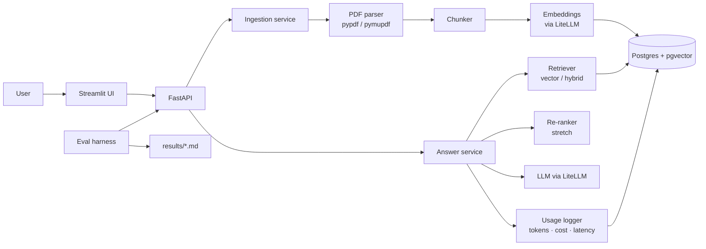
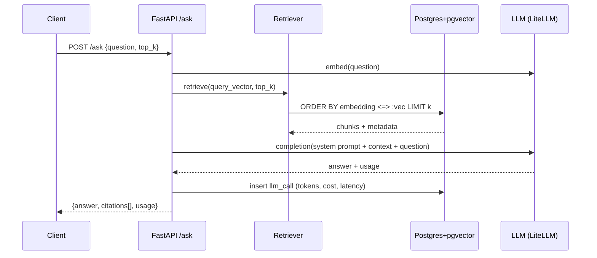

# RAG Document Assistant — Project Plan

A Python project: upload documents, ask questions, get answers
grounded in the documents with page-level citations — plus an **evaluation suite that
measures answer quality**, so every improvement is backed by a number.

---

## 1. Goals

### Goals
- Answer questions over PDFs with answers grounded in the documents and cited to the page.
- Measure retrieval and answer quality with a repeatable evaluation suite, so every change is
  backed by a number.
- Track the token usage, cost and latency of every LLM call.

### Success criteria
- Live demo URL anyone can try without signing up.
- README with architecture diagram, design decisions and an **evaluation results table**.
- At least **one measured improvement** over the baseline (accuracy, faithfulness, latency or cost).
- CI running lint + tests on every push.

### Non-goals
- No model training or fine-tuning (out of scope; possible stretch later).
- No user accounts / multi-tenancy in the MVP.

---

## 2. Scope

### MVP (must have)
1. Upload PDF documents (size/page limits enforced).
2. Ingestion: extract text per page → chunk → embed → store in Postgres + pgvector.
3. Ask a question → retrieve top-k chunks → LLM answers **only from context**, with citations `[doc, page]`.
4. "I don't know" behaviour when the answer is not in the documents.
5. Per-call token, cost and latency logging (LiteLLM usage).
6. Evaluation harness with a fixed question set and a results report.
7. Simple UI (Streamlit) + REST API (FastAPI).

### Stretch (pick after MVP, in this order)
1. **Hybrid search** — Postgres full-text (BM25-style) + vector, fused with Reciprocal Rank Fusion.
2. **Re-ranking** — cross-encoder (e.g. `BAAI/bge-reranker-base`) or an LLM re-ranker.
3. **Query rewriting** — multi-query / HyDE for vague questions.
4. **Streaming answers** (Server-Sent Events) in API and UI.
5. **Agent mode** — tool-calling agent that can search, open a page, and compare documents.
6. **React front end** replacing Streamlit.
7. **Guardrails** — prompt-injection detection on retrieved text, PII redaction in logs.

---

## 3. Dataset

Use public documents with a clear licence so the repo and demo are safe to publish:

- **Recommended:** GOV.UK / HMRC guidance (e.g. tax, employment, company filing guides) —
  published under the **Open Government Licence v3.0**, free to reuse with attribution.
- Alternative: public company annual reports (PDFs from investor-relations pages) — fine for a
  demo, but do not redistribute the PDFs in the repo; download them via a script instead.

Store a small sample (5–10 PDFs) via `scripts/download_corpus.py`, not committed binaries.

---

## 4. Architecture



### Request flow — ask a question


---

## 5. Tech stack (and why)

| Area | Choice | Why |
|---|---|---|
| Language | Python 3.12 | The main language of the LLM tooling ecosystem |
| Packaging | `uv` | Fast installs, reproducible lockfile |
| API | FastAPI + Pydantic v2 | Industry standard for Python AI APIs; auto OpenAPI docs |
| LLM access | LiteLLM | Model-agnostic (OpenAI, Azure OpenAI, Anthropic, local Ollama); built-in usage + cost |
| Embeddings | `text-embedding-3-small` via LiteLLM; local fallback `bge-small-en` | Cheap, good quality; local option = zero cost |
| Vector store | Postgres 16 + pgvector (HNSW index) | One DB for vectors, full-text search and logs |
| DB access | SQLAlchemy 2.0 + Alembic | Typed models + migrations |
| PDF parsing | `pymupdf` | Fast, keeps page numbers |
| Eval | Own harness + LLM-as-judge; optional `ragas` | Understand the metrics, not just call a library |
| UI | Streamlit (MVP) → React (stretch) | Fast demo first |
| Tests | pytest, pytest-asyncio, respx/httpx mocks | Standard Python testing |
| Quality | ruff (lint + format), mypy | Consistent style and type safety |
| CI | GitHub Actions | Lint + type-check + tests on every push |
| Packaging/deploy | Docker + docker-compose; deploy to Render / Fly.io, DB on Neon (free Postgres + pgvector) | Live demo URL |

---

## 6. Repository structure

```
rag-document-assistant/
├── app/
│   ├── main.py                 # FastAPI app factory, routers
│   ├── config.py               # pydantic-settings; reads .env
│   ├── api/
│   │   ├── documents.py        # upload / list / delete
│   │   ├── ask.py              # question answering
│   │   └── schemas.py          # Pydantic request/response models
│   ├── services/
│   │   ├── ingestion.py        # parse → chunk → embed → store
│   │   ├── chunking.py         # chunk strategies (fixed, recursive, by-heading)
│   │   ├── retrieval.py        # vector, full-text, hybrid (RRF)
│   │   ├── reranking.py        # stretch
│   │   ├── answering.py        # prompt assembly + LLM call + citation parsing
│   │   └── llm.py              # the ONLY module that imports litellm
│   ├── db/
│   │   ├── models.py           # SQLAlchemy models
│   │   ├── session.py
│   │   └── migrations/         # Alembic
│   └── prompts/
│       └── answer_v1.md        # versioned prompts, never inline strings
├── eval/
│   ├── datasets/qa_v1.jsonl    # question, reference answer, source doc+page
│   ├── run_eval.py             # runs a config, writes results
│   ├── metrics.py              # recall@k, MRR, correctness, faithfulness, citation accuracy
│   └── results/                # one markdown + json report per run
├── ui/streamlit_app.py
├── scripts/download_corpus.py
├── tests/                      # unit + integration
├── docs/
│   ├── PLAN.md                 # this file
│   └── designs/<feature>/      # requirement.md, technical-design.md per feature
├── docker-compose.yml          # api + postgres(pgvector)
├── Dockerfile
├── pyproject.toml
├── .env.example                # names only, never values
└── README.md
```

---

## 7. Data model (Postgres)

| Table | Key columns | Notes |
|---|---|---|
| `documents` | `id uuid pk`, `filename`, `sha256 unique`, `page_count`, `created_at` | `sha256` stops duplicate uploads |
| `chunks` | `id`, `document_id fk`, `page`, `chunk_index`, `text`, `token_count`, `embedding vector(1536)`, `tsv tsvector` | HNSW index on `embedding` (cosine); GIN index on `tsv` for hybrid search |
| `queries` | `id`, `question`, `answer`, `config_name`, `created_at` | One row per /ask |
| `llm_calls` | `id`, `query_id fk null`, `purpose` (embed/answer/judge/rerank), `model`, `prompt_tokens`, `completion_tokens`, `cost_usd`, `latency_ms`, `created_at` | **Every** LLM call logged |
| `eval_runs` | `id`, `config jsonb`, `dataset_version`, `metrics jsonb`, `git_sha`, `created_at` | Makes every result reproducible |

Indexes are justified by the queries in §8; no speculative indexes.

---

## 8. API contract

| Method | Route | Request | Response | Errors |
|---|---|---|---|---|
| `POST` | `/documents` | multipart PDF (≤ 20 MB, ≤ 300 pages) | `201 {id, filename, page_count, chunk_count}` | 400 not a PDF, 409 duplicate, 413 too large |
| `GET` | `/documents` | — | `200 [{id, filename, page_count, created_at}]` | — |
| `DELETE` | `/documents/{id}` | — | `204` | 404 |
| `POST` | `/ask` | `{question: str(1..1000), top_k: int=5, mode: "vector"\|"hybrid"}` | `200 {answer, citations:[{document, page, snippet}], usage:{tokens, cost_usd, latency_ms}}` | 422 validation, 502 LLM provider error |
| `GET` | `/health` | — | `200 {db: ok, llm: ok}` | 503 |

- One error shape everywhere: `{"error": {"code": "...", "message": "..."}}`.
- FastAPI's generated OpenAPI docs at `/docs` become part of the README (API documentation evidence).

---

## 9. Milestones

Each milestone ends with: tests green, README updated, a commit/PR, and (from M3) an eval run.
Estimated effort assumes evenings/weekends.

### M0 — Project setup (½ day)
- `uv init`, ruff, mypy, pytest, pre-commit, `.gitignore`, `.env.example`.
- docker-compose with `pgvector/pgvector:pg16`.
- GitHub repo (public), GitHub Actions CI: `ruff check`, `mypy`, `pytest`.
- **Done when:** CI passes on an empty app with `/health`.

### M1 — Ingestion (1–2 days)
- PDF → pages (pymupdf) → recursive chunking (~500 tokens, 50 overlap) → embeddings → `chunks`.
- Dedup by sha256; enforce size/page limits.
- Unit tests for chunking edge cases (empty pages, very long pages, tables-as-text).
- **Done when:** uploading 5 PDFs stores chunks with page numbers; re-upload returns 409.

### M2 — Question answering (1–2 days)
- Vector retrieval (cosine, top-k), prompt in `app/prompts/answer_v1.md`.
- Answer must cite `[n]` markers mapped to chunk → document + page.
- Refuse when context is insufficient ("I couldn't find that in the documents").
- Log every LLM call to `llm_calls`.
- **Done when:** `/ask` returns grounded answers with correct citations on 5 hand-checked questions.

### M3 — Evaluation harness (2–3 days) ← the most important milestone
- Build `qa_v1.jsonl`: **40–60 questions** written by you from the corpus, each with reference
  answer + source doc/page. Include: direct lookups, multi-chunk answers, numbers/dates,
  and **10 unanswerable questions** (tests refusal).
- Metrics (see §10). Write `eval/results/<date>-<config>.md` + insert into `eval_runs`.
- **Done when:** one command (`uv run python -m eval.run_eval --config baseline`) produces a
  results table. Commit the **baseline** numbers.

### M4 — Improve and measure (2–4 days)
Run each experiment against the same dataset; keep the ones that win:

| # | Experiment | Expected effect |
|---|---|---|
| E1 | Chunk size 300 / 500 / 800 tokens | Retrieval recall vs context noise |
| E2 | Hybrid search (full-text + vector, RRF) | Better on exact terms, codes, names |
| E3 | Re-ranking top-20 → top-5 | Higher precision, more latency/cost |
| E4 | Query rewriting (multi-query) | Better on vague questions |
| E5 | Cheaper answer model | Cost ↓ — check accuracy holds |

- **Done when:** README has a before/after table and a short write-up of what worked and why.

### M5 — UI, Docker, deploy (1–2 days)
- Streamlit: upload, ask, show answer with clickable citations + usage panel.
- Dockerfile (multi-stage), deploy API + UI; Neon Postgres.
- Demo protection: rate limit per IP, max docs, a spend cap on the API key.
- **Done when:** a public URL works end-to-end.

### M6 — Polish (1 day)
- README: problem → demo GIF → architecture → design decisions → **results table** → how to run.

**Total: roughly 3–4 weekends for M0–M6.** Stretch items afterwards.

---

## 10. Evaluation methodology

| Metric | What it measures | How |
|---|---|---|
| Retrieval recall@k | Did the right page appear in the top-k? | Compare retrieved (doc, page) to the labelled source |
| MRR | How high was the right chunk ranked? | 1 / rank of first correct hit |
| Answer correctness | Is the answer right? | LLM-as-judge vs reference answer (score 0/1 or 1–5), judge prompt versioned |
| Faithfulness | Is every claim supported by the retrieved context? | LLM-as-judge over (answer, context) |
| Citation accuracy | Do citations point to pages that support the claim? | Check cited pages ⊆ supporting pages |
| Refusal accuracy | Does it say "not found" on unanswerable questions? | Exact behaviour check on the 10 negatives |
| Latency p50 / p95 | Speed | From `llm_calls` |
| Cost per query | Money | Sum of `cost_usd` per query |

Rules:
- **Fixed dataset version** per comparison; never tune on the questions you report.
  Split 70/30: tune on "dev", report on "test".
- Judge with a **different (stronger) model** than the one answering; spot-check 10 judge
  verdicts by hand and note the agreement rate in the README.
- Every run stores config + git SHA → reproducible.

### Results table template (README)
| Config | Recall@5 | Correctness | Faithfulness | Refusal acc. | p50 latency | Cost/query |
|---|---|---|---|---|---|---|
| baseline (vector, 500 tok) | | | | | | |
| + hybrid | | | | | | |
| + re-rank | | | | | | |

---

## 11. Testing strategy

- **Unit:** chunking, RRF fusion maths, citation parsing, prompt assembly, metrics functions.
- **Integration:** FastAPI endpoints with a real Postgres (docker / testcontainers); LLM calls
  mocked at the `app/services/llm.py` boundary — tests never spend money.
- **Contract:** response models validated by Pydantic; OpenAPI schema snapshot test.
- **Eval ≠ tests:** eval runs are manual/scheduled, not part of CI (cost + non-determinism).
- Target: core services ≥ 80% coverage; no coverage theatre on glue code.

---

## 12. Security & cost controls

- Secrets only in `.env` (git-ignored) and the host's secret store; `.env.example` lists names only.
- Upload limits (type, size, pages); reject encrypted PDFs.
- Treat retrieved text as **untrusted**: system prompt tells the model to ignore instructions
  inside documents (prompt-injection). Stretch: detection step.
- Never log full documents or API keys; log question text only in the demo with a notice.
- Public demo: per-IP rate limit, daily spend cap on the provider key, max corpus size.

---

## 13. Conventions

- Licence the repo **MIT**; attribute the OGL corpus in the README.
- Small, frequent commits with clear messages.
- Each feature: written requirement and technical design in `docs/designs/<feature>/`,
  implemented on a `feature/<short-description>` branch, reviewed before merge.

---

## 14. Risks

| Risk | Mitigation |
|---|---|
| Scope creep (agents, React) before MVP works | Strict milestone order; stretch only after M6 |
| API costs | Small models, local embeddings fallback, spend cap, cached eval embeddings |
| Weak eval dataset → meaningless numbers | Write questions by hand from the source, dev/test split, include negatives |
| PDF parsing quality (tables, columns) | Pick text-heavy guidance docs; note limitation in README |
| Demo abuse | Rate limiting, spend cap, corpus limit |
| Stalling | Ship M0–M3 first: a repo with baseline eval numbers is already useful |
